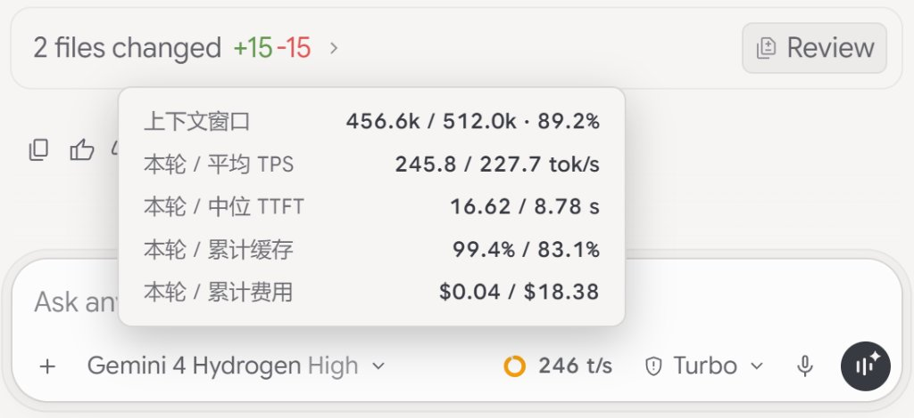
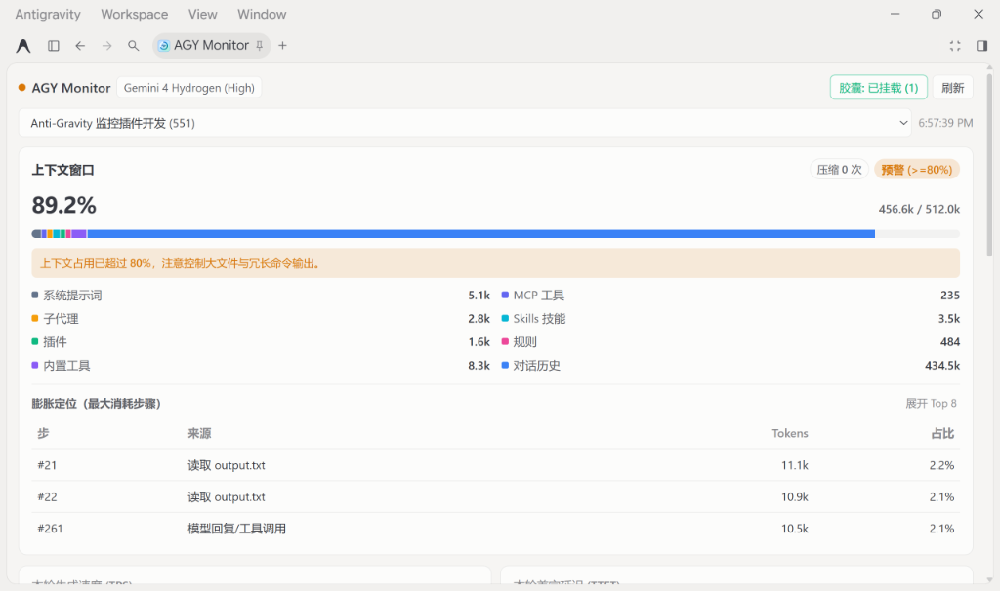
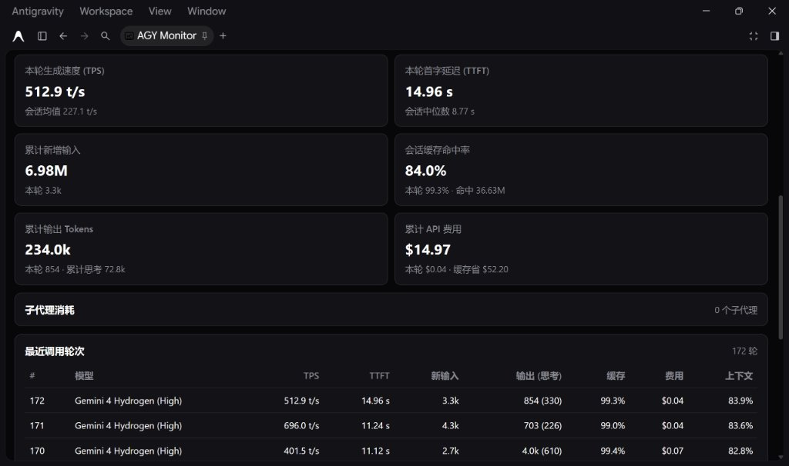

<div align="center">
  
  <h1>AGY Monitor</h1>
  <p>适用于 Google Antigravity 2.0 桌面端的监控插件，源码采用严格模式 TypeScript 编写，通过 tsc 编译为原生 Node.js ESM 与前端 JS 运行，无第三方运行时依赖。</p>
</div>

## 界面预览



| 浅色主题 | 深色主题 |
| :---: | :---: |
|  |  |

---

## 功能概览

- **上下文窗口监控**：读取当前对话的已用 Token、模型上下文上限、占用百分比、80% / 95% 阈值预警，以及 8 项官方构成拆分（对话历史、内置工具、系统提示词、Skills、子代理、插件、规则、MCP 工具）。
- **压缩与占用排行**：统计当前对话的上下文压缩（`CHECKPOINT`）次数，并按步骤展示主要上下文占用项（如大文件读取、长命令输出）。
- **性能与用量指标**（性能指标展示本轮结果，用量与费用展示会话累计）：
  - **本轮生成速度（TPS, `tok/s`）** 与会话加权均值（过滤 `<50ms` 瞬时响应）
  - **本轮首字延迟（TTFT）** 与会话中位数
  - **累计新增输入（Uncached）** 与 **会话 Prompt 缓存命中率**
  - **累计输出 Tokens**（含思考与正文细分）
  - **累计 API 费用**：每 6 小时从 [models.dev](https://models.dev/api.json) 同步一次模型费率并缓存在本地；离线时沿用缓存或显示为 `--`。
- **子代理（Subagent）消耗**：默认折叠为单行汇总，存在子代理调用时可展开查看各子代理的模型、轮次与 Token 明细。
- **最近调用轮次表**：按轮展示调用模型、TPS、TTFT、新输入、输出（含思考）、缓存命中率、费用与上下文占比。
- **可选输入框胶囊（CDP 注入）**：当桌面端启用 `--remote-debugging-port=0` 时，在内存中向聊天输入框工具栏注入状态胶囊，不修改 `app.asar`。

---

## 安装方式

### 方式一：从 GitHub Releases 下载

1. 从 [Releases](https://github.com/czefan/agy-monitor/releases) 下载 `agy-monitor-*.zip`。
2. 解压至 Antigravity 全局插件目录，确保包含 `~/.gemini/config/plugins/agy-monitor/plugin.json`：
   - **Windows**：`%USERPROFILE%\.gemini\config\plugins\agy-monitor\`
   - **macOS / Linux**：`~/.gemini/config/plugins/agy-monitor/`
3. 重启 Antigravity 2.0，在 **Customizations → Installed** 中确认启用 **AGY Monitor**，随后在对话右侧辅助栏打开 **AGY Monitor**。

### 方式二：从源码克隆与构建

由于仓库仅保留 TypeScript 源码，不提交编译产物，从源码安装需使用 `pnpm` 构建并同步到插件目录（Windows / macOS / Linux 通用）：

```bash
git clone https://github.com/czefan/agy-monitor.git
cd agy-monitor
pnpm install
pnpm sync
```

> **说明（Windows）**：Antigravity 在 Windows 下扫描插件时会跳过 NTFS 目录联接（`mklink /J`）或符号链接，需使用真实目录（`pnpm sync` 会直接复制构建产物到真实目录）。

---

## 可选：开启输入框胶囊

Antigravity 2.0 桌面端默认未开启远程调试端口，初始状态下仅右侧辅助面板运行。如需同时在聊天输入框旁显示状态胶囊：

1. 右键 Antigravity 桌面或开始菜单快捷方式，打开**属性**。
2. 在**目标（Target）**末尾追加空格与 `--remote-debugging-port=0`。
3. 完全退出并重启 Antigravity，插件检测到 `DevToolsActivePort` 后即会挂载胶囊。

---

## 数据范围

- 会话与性能数据均从本地 Language Server RPC（`127.0.0.1`）读取，不上传对话内容、代码或凭证。
- 模型单价每 6 小时请求一次公开只读接口 `https://models.dev/api.json`。
